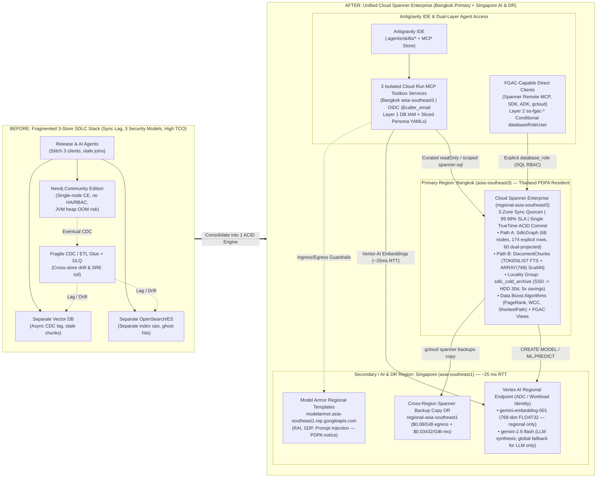

# Cloud Spanner Enterprise SDLC Knowledge Graph & GraphRAG Workshop

**Consolidate Neo4j Community Edition + a Separate Vector Database + a Separate Keyword Search Cluster into One Strongly Consistent Cloud Spanner Enterprise Platform.**

This hands-on enterprise workshop demonstrates **Use Case 4**: replacing a fragile 3-store SDLC architecture with a single ACID **Cloud Spanner Enterprise** database combining **Spanner Graph (ISO GQL)**, **Full-Text Search**, **ScaNN Vector Search**, **Serverless Data Boost Graph Algorithms**, and **secure multi-agent MCP Toolbox for Databases** access — anchored on the fictional **Acme Commerce Platform** and designed for Southeast Asia **Thailand PDPA** residency.

---

## Executive Overview & Hero Scenario

Engineering teams at **Acme Commerce Platform** maintain `12` microservices, `24` HTTP APIs, `10` Architecture Decision Records (ADRs), `14` compliance/SLA requirements, `8` engineering teams, and `45` unstructured Markdown design docs and runbooks. Previously, answering a single release-readiness question required stitching together **Neo4j Community Edition**, a **managed Vector DB**, and a **managed OpenSearch/Elasticsearch cluster** connected by brittle CDC pipelines.

Throughout Labs 1–8, you build and verify a unified **Cloud Spanner Enterprise** GraphRAG engine that answers the **Hero Question** in a single read-only ACID transaction with zero cross-store sync lag:

> **Hero Question:** *"What breaks if we change `POST /v2/payments/charge` (`api-payments-charge-v2`)?"*
>
> - **Deterministic 7-Row Impact Blast Radius** (`MATCH TRAIL` cycle-safe over `svc-orders <-> svc-notifications`):
>   1. `svc-billing` — Hop `1`, `DIRECT_SYNC`, `TIER_0` / `CRITICAL`, `team-billing` (`#billing-ledger`) — **flags legacy `AT_RISK` call to `DEPRECATED` `api-payments-charge-v1`**
>   2. `svc-checkout` — Hop `1`, `DIRECT_SYNC`, `TIER_0` / `CRITICAL`, `team-checkout` (`#checkout-orders`)
>   3. `svc-orders` — Hop `2`, `TRANSITIVE_UPSTREAM`, `TIER_1` / `HIGH`, `team-checkout` (`#checkout-orders`)
>   4. `svc-partner-gw` — Hop `2`, `TRANSITIVE_UPSTREAM`, `TIER_1` / `HIGH`, `team-integrations` (`#partner-messaging`)
>   5. `svc-notifications` — Hop `3`, `TRANSITIVE_UPSTREAM`, `TIER_2` / `MEDIUM`, `team-integrations` (`#partner-messaging`)
>   6. `svc-webhooks` — Hop `3`, `TRANSITIVE_UPSTREAM`, `TIER_2` / `MEDIUM`, `team-integrations` (`#partner-messaging`)
>   7. `svc-analytics` — Hop `3`, `DATA_FEED_CONSUMER`, `TIER_2` / `LOW`, `team-data` (`#data-analytics`) *(non-blocking analytical feed isolated from OLTP outage impact)*
> - **5 Governing ADRs:** `ADR-004` (`MANDATES`), `ADR-005`, `ADR-006`, `ADR-008`, `ADR-010` (`CONSTRAINS`)
> - **5 Applicable Requirements:** `REQ-001` (PCI-DSS 4.0), `REQ-002` (Tier-0 SLA & 45ms fraud budget), `REQ-003` (`> $500` fail-closed), `REQ-005` (SOX idempotent ledger), `REQ-006` (Zero-Trust mTLS/OIDC)
> - **9 Verifiable Unstructured Markdown Citations:** Grounded verbatim in `data/unstructured/` (`tok_pci_v2_<32hex>`, `45ms`, `> $500`, `180-day` Tier-0 freeze, `Idempotency-Key`, `AT_RISK` v1 sunset).

---

## BEFORE vs. AFTER Architecture (Bangkok Primary + Singapore AI & DR Secondary)

Cloud Spanner does not currently offer a pre-built dual-region or multi-region configuration pairing Bangkok (`asia-southeast3`) and Singapore (`asia-southeast1`). The reference Southeast Asia enterprise topology keeps all primary operational SDLC state inside Thailand (`regional-asia-southeast3`, 3-zone synchronous quorum, `99.99%` SLA, Thailand PDPA data residency) while pairing with Singapore (`asia-southeast1`, `~25 ms` RTT) for Vertex AI embeddings/LLM inference, Model Armor regional templates, and cross-region Spanner backup disaster recovery:



---

## Locked Workshop Guardrails & Invariants (`WORKSHOP_SPEC.json`)

| Guardrail / Invariant | Locked Workshop Contract | Why It Matters in Production |
| :--- | :--- | :--- |
| **`INV-01` Dialect & Edition** | **GoogleSQL** (`GOOGLE_STANDARD_SQL`) + **Cloud Spanner Enterprise** (`ENTERPRISE`) | Unlocks Spanner Graph (ISO GQL), Full-Text Search, ScaNN Vector Search, Locality Groups, and Managed Autoscaler. |
| **Regional Residency & Fallback** | Primary: **Bangkok** (`asia-southeast3` / `regional-asia-southeast3`, `1.05x` US). Secondary/AI/DR: **Singapore** (`asia-southeast1`, `1.144x` US, `~25 ms` RTT). | Keeps primary operational data PDPA-resident in Thailand (`$0.00/GiB` intra-region replication) while using Singapore for Vertex AI, Model Armor, and cross-region backup copy DR (`$0.08/GiB`). |
| **Compute & Backup Floor** | Workshop sandbox: **`100` PU** (`$1.0332` / 8 hr compute, `~$1.15` total/attendee) with `--default-backup-schedule-type=NONE`. Production: **`>= 1,000` PUs (1 node)** + `AUTOMATIC` backups. | Sub-node instances (`< 1,000` PUs) run a single server task per zone and do **not** support Managed Autoscaler or Remote Functions. |
| **`INV-02`–`INV-04` Graph Integrity** | Unique element aliases in `CREATE PROPERTY GRAPH SdlcGraph`; exact composite PK arity/type on `SOURCE KEY`/`DESTINATION KEY`; graph-wide property type uniqueness. | Prevents DDL compilation errors and silent schema drift across 6 node tables and 14 edge definitions (6 explicit + 4 dual-projected + 4 view-backed). |
| **`INV-05` Explicit View Security** | Every SQL view declares `SQL SECURITY INVOKER` (or `DEFINER` for `TeamScopedAssetsView`); view-backed graph elements declare explicit `KEY (...)`. | Enforces least-privilege view execution; remember `CREATE OR REPLACE VIEW` resets `GRANT SELECT ON VIEW` — always re-run `04b_fgac_grants_rerunnable.sql`. |
| **`INV-06` Dual-Cascade Ban** | Never combine `INTERLEAVE IN PARENT T ON DELETE CASCADE` with a self-referencing cascading FK to `T` on the same table. | `ServiceDependsOnService` and `AdrSupersedesAdr` use standalone dual-FK; `ServiceDependsOnAlgo` (Lab 4 Data Boost) uses `INTERLEAVE IN PARENT Services ON DELETE CASCADE` + `NOT ENFORCED` FK. |
| **`INV-07` Isolated Dynamic Graph** | Keep `DYNAMIC LABEL` / `DYNAMIC PROPERTIES` tables (`GraphNode`/`GraphEdge`) inside dedicated `SdlcDynamicGraph` with lowercase `CHECK` constraints and `PROPERTIES ALL COLUMNS EXCEPT (properties)`. | Spanner prohibits mixing static tables with `DYNAMIC LABEL` in one graph; uppercase dynamic labels/keys are silently skipped at query time. |
| **`INV-08` Vector & ScaNN Rules** | `ARRAY<FLOAT32>(vector_length=>768)`, `WHERE embedding IS NOT NULL` on both `CREATE VECTOR INDEX` and `APPROX_COSINE_DISTANCE`, single-table CTE isolation (zero `JOIN` inside ANN `SELECT`), never ANN on edges. | Guarantees the query optimizer selects `IdxDocumentChunksEmbedding` ScaNN index scans instead of falling back to expensive full table scans. |
| **`INV-09` RRF, FTS & Embeddings** | No general `ROW_NUMBER()` — compute RRF (`k=60`) via `UNNEST(ARRAY(SELECT ... ORDER BY ... LIMIT k)) AS x WITH OFFSET AS rank`. Run FTS in **read-only** transactions. Bind `gemini-embedding-001` strictly to regional `asia-southeast1` (never `global`). | Avoids GoogleSQL unsupported analytic syntax, FTS transaction-mode errors, and Vertex AI regional predict-API rejections (`global` fallback applies strictly to `gemini-2.5-flash` LLM synthesis). |
| **MCP Toolbox & Dual-Layer Auth** | Curated `spanner-sql` tools (`readOnly: true`, zero `spanner-execute-sql`, zero `templateParameters`, zero `databaseRole` in `tools.yaml`, secretless Vertex AI ADC embeddings, OIDC `authServices` `@caller_email`). | Separates Layer 1 Cloud Run MCP Toolbox DB IAM (`roles/spanner.databaseReader`/`databaseUser` + sliced persona YAMLs) from Layer 2 `sa-fgac-*` accounts (`fineGrainedAccessUser` + conditional `databaseRoleUser`) for `database_role`-aware clients. |

---

## Delivery Agendas: 4-Hour Express vs. 8-Hour Deep-Dive

Both tracks cover all **7 customer requirements** and finish with the live Hero Blast-Radius GraphRAG query, prompt-injection fail-closed proof, and verified Bangkok Enterprise TCO readout. See [docs/00_facilitator_guide.md](docs/00_facilitator_guide.md) for instructor checklists, demo cues, and cohort budgets.

| Lab | Req # | Participant Guide | 4h Express (240m) | 8h Deep-Dive (480m) | Hands-On Deliverable (`starter/`) |
| :-: | :-: | :--- | :-: | :-: | :--- |
| **0** | Ops | [00_facilitator_guide.md](docs/00_facilitator_guide.md) | Pre-work | Pre-work | Instructor runbook, `~$1.15/attendee` Bangkok budget, Q&A playbook |
| **1** | 1 | [01_neo4j_community_migration.md](docs/01_neo4j_community_migration.md) | 30 min | 60 min | APOC streaming export + `starter/sql/09_opencypher_to_gql_cookbook.sql` (`MATCH TRAIL`, `FOR`, `SAFE_TO_JSON`) |
| **2** | 2 | [02_two_path_sdlc_workshop.md](docs/02_two_path_sdlc_workshop.md) | 20 min | 45 min | Path A/B convergence + `starter/sql/10_validate_migration_parity.sql` (68/174/60/45 parity & traps) |
| **3** | 3 | [03_database_design_and_ingestion.md](docs/03_database_design_and_ingestion.md) | 45 min | 90 min | `01_path_a_schematized.sql`, `03_indexes_fts_vector_postload.sql`, Path A & Path B Python loaders |
| **4** | 4 | [04_search_strategy_options.md](docs/04_search_strategy_options.md) | 25 min | 60 min | `05_search_strategies_benchmark.sql` (FTS/Fuzzy/JSON/KNN/ScaNN) + `08_graph_algorithms_criticality.sql` (`PageRank`) |
| **5** | 5 | [05_hybrid_retrieval_and_graphrag.md](docs/05_hybrid_retrieval_and_graphrag.md) | 45 min | 75 min | `06_hybrid_rrf_rsf_filtered.sql` (RRF without `ROW_NUMBER()`) + `07_hero_api_blast_radius_graphrag.sql` + Zero-Sync-Lag ACID Proof |
| **6** | 6 | [06_mcp_toolbox_agent_security.md](docs/06_mcp_toolbox_agent_security.md) | 40 min | 75 min | `04_fgac_roles_views.sql`, `starter/mcp/tools.yaml`, `adk_multi_agent_demo.py`, Antigravity MCP & prompt-injection fail-closed demo |
| **7** | 7 | [07_sizing_and_cost_tco.md](docs/07_sizing_and_cost_tco.md) | 20 min | 45 min | Verified Bangkok/Singapore pricing, CUDs, HDD tiering, DR egress, 3-store TCO + `starter/tools/customer_scale_worksheet.json` |
| **8** | 7 | [08_observability_and_troubleshooting.md](docs/08_observability_and_troubleshooting.md) | 15 min | 30 min | `11_observability_and_studio_viz.sql` (`SAFE_TO_JSON(p)`, `SPANNER_SYS` Insights), Key Visualizer, Pre-Splitting, DR copy & cleanup |

---

## Quickstart (`Makefile` Targets — Zero External Test Dependencies)

Every offline verification target runs purely on the **Python 3 standard library** (`python3 -m unittest` — zero `pytest` or GCP credentials required).

```bash
# 1. Inspect all targets and configurable overrides
make help

# 2. Verify all 8 Antigravity skills, frontmatter, and MCP config
make validate-skills

# 3. Run the complete 7-module offline unittest suite
make test

# 4. Confirm starter/ stubs fail before solving and solution/ passes 100%
make verify-starter-stubs
make TRACK=solution verify-lab LAB=all

# 5. Work through Labs 1-8 inside starter/ with instant green/red offline checks
make TRACK=starter verify-lab LAB=1
# ...repeat through LAB=8

# 6. Run stdlib pipeline dry-runs, Hero offline fixture replay, Lab 6 mock RBAC & Bangkok TCO
make dry-run-pipelines
make demo-mcp-mock
make sizing PRESET=all REGION=asia-southeast3 DR_BACKUP_REGION=asia-southeast1
```

### Live GCP Bangkok (`asia-southeast3`) Sandbox Lifecycle

> **Safety Gate:** Always copy `.env.example` to `.env`, set `GOOGLE_CLOUD_PROJECT`, and verify `gcloud config get-value project` before running any live cloud command.

```bash
cp .env.example .env
# Edit .env and set GOOGLE_CLOUD_PROJECT=<your-sandbox-project>

# Install Python SDKs (google-cloud-spanner, google-genai, pyyaml)
make install

# 1. Provision Bangkok 100-PU Enterprise sandbox (--default-backup-schedule-type=NONE) + base DDL
make provision-gcp
# Quota fallback to Singapore if needed: make provision-gcp REGION=asia-southeast1

# 2. Load Path A structured graph (nodes -> edges) and Path B 45 Markdown docs (asia-southeast1 embeddings)
python3 solution/pipelines/neo4j_to_spanner_loader.py
python3 solution/pipelines/unstructured_graphrag_ingest.py

# 3. Apply 4-stage post-load (03a synonyms -> 03b Vertex AI model -> 03 batched indexes -> ANALYZE)
bash scripts/provision_workshop_env.sh apply-postload

# 4. Run live Hero Queries (A = Exact KNN, B = ScaNN ANN, C = SdlcDynamicGraph) & full live verification
python3 labs/run_hero_query.py --query B --api-id api-payments-charge-v2 \
  --check-fixture solution/sql/fixtures/07_hero_expected_rows.json
bash scripts/verify_live_gcp.sh

# 5. Optional Singapore DR backup copy, then clean teardown (zero lingering charges)
bash scripts/provision_workshop_env.sh backup-to-singapore
make cleanup-gcp
```

---

## 8-Skill Antigravity Catalog (`.agents/skills/`)

This repository bundles **8 modular Antigravity IDE skills** alongside the always-on workspace rule [`.agents/rules/spanner-graph-workshop.md`](.agents/rules/spanner-graph-workshop.md). **Skills #1–#7 are 100% production-reusable** with zero Acme Commerce hardcoding — copy `.agents/skills/spanner-*` straight into your enterprise repositories after the workshop.

| # | Skill Name | Scope | Primary Labs | Purpose & Activation Scope |
| :-: | :--- | :---: | :---: | :--- |
| **1** | [`spanner-enterprise-platform-ops`](.agents/skills/spanner-enterprise-platform-ops/SKILL.md) | Production | 2, 7, 8 | Editions, CUDs, Bangkok/Singapore DR topology, dialects, KV, Queues, CLI/SDKs/Emulator, Managed Autoscaler, PITR, backups, drop protection. |
| **2** | [`spanner-schema-and-data-modeling`](.agents/skills/spanner-schema-and-data-modeling/SKILL.md) | Production | 3 | Split-safe PKs, `INTERLEAVE IN PARENT` vs `INTERLEAVE IN`, covering/expression indexes, FKs (`INV-06` dual-cascade ban), views/`SECURE_CONTEXT()`, Locality Groups, TTL, Change Streams DDL. |
| **3** | [`spanner-graph-modeling-and-gql`](.agents/skills/spanner-graph-modeling-and-gql/SKILL.md) | Production | 3, 4, 5, 8 | `CREATE PROPERTY GRAPH`, structural invariants, dual-projected edges, view-backed & `DYNAMIC LABEL` graphs, ISO GQL (`TRAIL`, `IS_FIRST`, `factorized_mode`), Data Boost Graph Algorithms (`PageRank`, `WCC`, `ShortestPath`), `SAFE_TO_JSON` Studio viz. |
| **4** | [`spanner-search-ai-and-graphrag`](.agents/skills/spanner-search-ai-and-graphrag/SKILL.md) | Production | 4, 5 | Vertex AI `CREATE MODEL` + `ML.PREDICT` embeddings (`asia-southeast1`), throttled PDML backfills, FTS (`SEARCH`, Custom Dictionaries, fuzzy n-grams), Exact KNN, ScaNN `CREATE VECTOR INDEX`, RRF/RSF/Filtered Hybrid Search, GraphRAG. |
| **5** | [`spanner-migration-and-neo4j-playbook`](.agents/skills/spanner-migration-and-neo4j-playbook/SKILL.md) | Production | 1 | 7-stage migrations (SMT, Datastream+Dataflow CDC, DVT, cutover), Neo4j CE APOC export & nodes-before-edges loading, openCypher v9 → ISO GQL parity, Elasticsearch → Spanner FTS. |
| **6** | [`spanner-mcp-toolbox-and-agent-security`](.agents/skills/spanner-mcp-toolbox-and-agent-security/SKILL.md) | Production | 6 | Antigravity MCP Store/`mcp_config.json`, ADK `ToolboxToolset`/`SpannerToolset`, Spanner Remote MCP, `tools.yaml` hardening, dual-layer DB IAM vs conditional `databaseRoleUser` FGAC, Model Armor, CMEK, VPC-SC. |
| **7** | [`spanner-performance-observability-and-sizing`](.agents/skills/spanner-performance-observability-and-sizing/SKILL.md) | Production | 7, 8 | Query Optimizer/`ANALYZE`, execution plans, `SPANNER_SYS` Insights (Query/Lock/Txn/Read), Key Visualizer, pre-splitting, CPU targets (65%/45%), node capacity & Bangkok/Singapore 3-store TCO. |
| **8** | [`sdlc-graphrag-workshop-guide`](.agents/skills/sdlc-graphrag-workshop-guide/SKILL.md) | Workshop | 2 *(all support)* | Acme Commerce 68/174/60/234/45 dataset catalog, Hero `api-payments-charge-v2` contract, `starter/` `TODO(Lab 1–8)` checkpoints, `Makefile` targets, and troubleshooting runbook. |

---

## Repository Directory Map (`starter/` vs. `solution/`)

Participants edit **only files inside `starter/`**; `data/`, `solution/`, and fixtures stay intact as the verified reference implementation.

```text
spanner-graph-sdlc-workshop/
├── README.md                              # Executive overview, architecture, agendas & quickstart
├── WORKSHOP_SPEC.json                     # Canonical machine-readable workshop contract
├── WORKSHOP_CONTENT_PLAN.md               # Curriculum design & 7-requirement outcomes matrix
├── GEMINI.md                              # Agent workspace orientation & locked invariants
├── Makefile                               # 11 offline/live targets (stdlib unittest, zero pytest)
├── .env.example                           # Bangkok primary + Singapore Vertex AI/DR env template
├── .agents/
│   ├── rules/spanner-graph-workshop.md    # Always-on safety, residency, SQL & MCP guardrails
│   └── skills/                            # 8 modular Antigravity skills (7 production + 1 guide)
├── .antigravity/
│   ├── mcp_config.json                    # Zero-secret Antigravity IDE MCP server templates
│   └── README.md                          # MCP Store, npx, binary & Cloud Run setup guide
├── data/
│   ├── structured/                        # Path A: Neo4j CE Docker/APOC + 5 node CSVs + 10 edge CSVs + JSONLs
│   └── unstructured/                      # Path B: 45 Markdown docs (services, apis, adrs, requirements, owners)
├── docs/
│   ├── 00_facilitator_guide.md            # Instructor runbook, ~$1.15/attendee budget, Q&A & teardown
│   └── 01..08_*.md                        # Complete Module 1–8 participant lab guides
├── labs/
│   └── run_hero_query.py                  # Parameterized read-only Hero Query runner (A/B/C/all, --dry-run)
├── scripts/
│   ├── provision_workshop_env.sh          # create | apply-postload | backup-to-singapore | cleanup
│   ├── setup_antigravity_skills.sh        # Audits all 8 skills, rule file & MCP config (--link-legacy)
│   ├── verify_live_gcp.sh                 # Live DDL, ScaNN PLAN, Hero Query, FGAC & DR verification
│   └── verify_lab.py                      # Instant offline green/red grader for starter/ vs solution/
├── starter/                               # PARTICIPANT WORKSPACE: 15 TODO(Lab 1–8) exercise stubs
│   ├── README.md                          # Step-by-step participant starter guide
│   ├── sql/                               # 10 SQL/GQL stubs (01, 03, 04, 05, 06, 07, 08, 09, 10, 11)
│   ├── pipelines/                         # 2 loader stubs (neo4j_to_spanner_loader, unstructured_graphrag_ingest)
│   ├── mcp/                               # 2 Lab 6 stubs (tools.yaml, adk_multi_agent_demo.py)
│   └── tools/customer_scale_worksheet.json# Lab 7 interactive customer sizing worksheet
├── solution/                              # VERIFIED REFERENCE IMPLEMENTATION
│   ├── sql/                               # Complete SQL/GQL scripts (01–11, 03a–03d, 04b) + fixtures/
│   ├── pipelines/                         # Complete Path A/B loaders, Dataflow script, apply_postload & offline Hero replay
│   ├── mcp/                               # Hardened tools.yaml, 3 rendered personas/*.yaml, IAM/Model Armor & ADK demo
│   └── tools/sizing_calculator.py         # Verified 2026 Bangkok/Singapore sizing & 3-store TCO engine
└── tests/                                 # 7 stdlib unittest modules verifying all contracts offline
```

---

## Official Public Documentation

- [Cloud Spanner Documentation](https://docs.cloud.google.com/spanner/docs)
- [Spanner Graph Overview & ISO GQL Reference](https://docs.cloud.google.com/spanner/docs/graph/overview)
- [Spanner Graph Algorithms (Data Boost)](https://docs.cloud.google.com/spanner/docs/graph/graph-algorithms)
- [Full-Text Search in Cloud Spanner](https://docs.cloud.google.com/spanner/docs/full-text-search)
- [Vector Search: Exact KNN & ScaNN ANN](https://docs.cloud.google.com/spanner/docs/find-approximate-nearest-neighbors)
- [Fine-Grained Access Control (FGAC)](https://docs.cloud.google.com/spanner/docs/fgac-about)
- [Cloud Spanner Pricing](https://cloud.google.com/spanner/pricing)
- [MCP Toolbox for Databases (Docs & GitHub)](https://github.com/googleapis/genai-toolbox)
- [Secure Agent Interactions with Cloud Spanner & MCP](https://docs.cloud.google.com/spanner/docs/secure-agent-interactions-mcp)
- [Cloud Spanner Best-Practice Samples](https://github.com/GoogleCloudPlatform/spanner-bb-samples)
