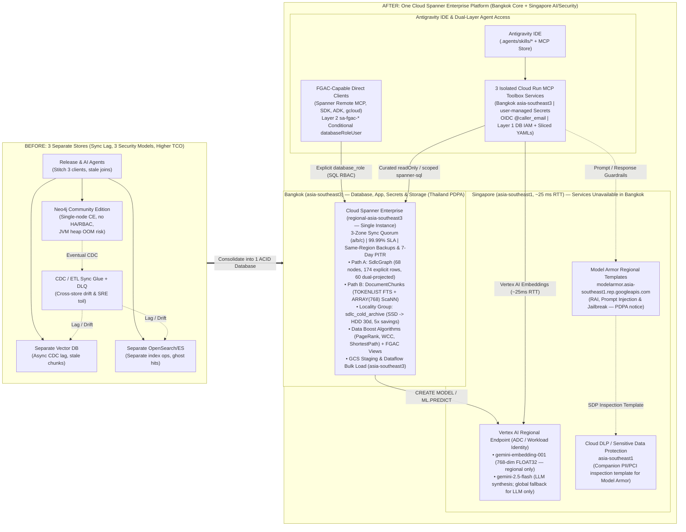

# Cloud Spanner Enterprise SDLC Knowledge Graph & GraphRAG Workshop

In this hands-on workshop, you'll replace Neo4j Community Edition, a standalone vector database, and a separate keyword search cluster with one Cloud Spanner Enterprise database for the fictional Acme Commerce platform. By the end, you'll answer multi-hop API blast-radius questions with citations in a single ACID transaction, lock down AI agent access through MCP Toolbox, and size the deployment for production.

---

## Start in 3 Steps

1. **Check your machine (offline, no Docker or GCP required):**
   ```bash
   make preflight
   ```
   Every offline simulator, pipeline dry-run, mock security demo, and lab grader runs on plain Python 3.10+. Docker Desktop is optional and only needed if you want a live local Neo4j container in Track B.

2. **Pick your track and mode:**
   - **Track A (4h Express):** Core hands-on exercises across Labs 1–8. Verify your work with `make TRACK=starter MODE=express verify-lab LAB=N`.
   - **Track B (8h Full):** All 15 starter files, including both Python ingestion loaders and Data Boost graph algorithms. Verify with `make TRACK=starter verify-lab LAB=N`.
   - **Offline vs. Live GCP:** You can complete and verify every lab offline first, or run them live against a 100-PU Cloud Spanner Enterprise sandbox in Bangkok (`asia-southeast3`) for about `$1.15` per attendee.

3. **Start Lab 1 and work exclusively inside `starter/`:**
   Open **[Lab 1: Neo4j Community Migration](docs/01_neo4j_community_migration.md)** and move through Labs 1–8 in order. Every file you need to edit lives in `starter/`—keep [`starter/README.md`](starter/README.md) open as your master file and line-number checklist, and peek at `solution/` only when you get stuck.

```bash
# Quick offline smoke test before opening Lab 1
make lab1-no-docker                       # Zero-Docker Neo4j CE & APOC simulator (WALK vs TRAIL + 15/15 SHA-256 parity)
make verify-starter-stubs                 # Confirms starter/ TODOs fail until solved and solution/ passes
make TRACK=starter verify-lab LAB=1       # Grade your Lab 1 edits (add MODE=express for Track A)
```

---

## Labs 1–8 Roadmap & `starter/` File Map

Edit only the files in the **Files You Edit (`starter/`)** column. Leave `data/` and `solution/` untouched so the offline grader and fixture checks stay clean.

| Lab | Guide | Track A / B | Files You Edit (`starter/`) | What You Build |
| :-: | :--- | :-: | :--- | :--- |
| **0** | [Facilitator Guide](docs/00_facilitator_guide.md) | Pre-work | *(Instructor runbook)* | Room prep, Track A/B pacing, `$1.15/attendee` budget, teardown |
| **1** | [Lab 1: Neo4j CE Migration](docs/01_neo4j_community_migration.md) | 30m / 60m | [`starter/sql/09_opencypher_to_gql_cookbook.sql`](starter/sql/09_opencypher_to_gql_cookbook.sql) | APOC export simulation + 5 openCypher-to-ISO-GQL translations (`MATCH TRAIL`, `FOR`, `SAFE_TO_JSON`) |
| **2** | [Lab 2: Two-Path SDLC Corpus](docs/02_two_path_sdlc_workshop.md) | 20m / 45m | [`starter/sql/10_validate_migration_parity.sql`](starter/sql/10_validate_migration_parity.sql) | 4-tier migration parity checks across 68 nodes, 174 explicit edges, 60 dual-projected edges, and 45 Markdown docs |
| **3** | [Lab 3: Schema & Ingestion](docs/03_database_design_and_ingestion.md) | 45m / 90m | [`starter/sql/01_path_a_schematized.sql`](starter/sql/01_path_a_schematized.sql)<br>[`starter/sql/03_indexes_fts_vector_postload.sql`](starter/sql/03_indexes_fts_vector_postload.sql)<br>[`starter/pipelines/neo4j_to_spanner_loader.py`](starter/pipelines/neo4j_to_spanner_loader.py)<br>[`starter/pipelines/unstructured_graphrag_ingest.py`](starter/pipelines/unstructured_graphrag_ingest.py) | Interleaved tables, `SdlcGraph` DDL, post-load covering/FTS/ScaNN indexes, and nodes-before-edges + Markdown loaders |
| **4** | [Lab 4: Search Strategies](docs/04_search_strategy_options.md) | 25m / 60m | [`starter/sql/05_search_strategies_benchmark.sql`](starter/sql/05_search_strategies_benchmark.sql)<br>[`starter/sql/08_graph_algorithms_criticality.sql`](starter/sql/08_graph_algorithms_criticality.sql) | FTS with synonyms, fuzzy n-grams, ScaNN ANN, and Data Boost `PageRank` criticality scoring |
| **5** | [Lab 5: Hybrid & Hero GraphRAG](docs/05_hybrid_retrieval_and_graphrag.md) | 45m / 75m | [`starter/sql/06_hybrid_rrf_rsf_filtered.sql`](starter/sql/06_hybrid_rrf_rsf_filtered.sql)<br>[`starter/sql/07_hero_api_blast_radius_graphrag.sql`](starter/sql/07_hero_api_blast_radius_graphrag.sql) | Server-side RRF (`UNNEST(ARRAY(...)) WITH OFFSET`) + single-query Hero API blast-radius GraphRAG |
| **6** | [Lab 6: MCP & Agent Security](docs/06_mcp_toolbox_agent_security.md) | 40m / 75m | [`starter/sql/04_fgac_roles_views.sql`](starter/sql/04_fgac_roles_views.sql)<br>[`starter/mcp/tools.yaml`](starter/mcp/tools.yaml)<br>[`starter/mcp/adk_multi_agent_demo.py`](starter/mcp/adk_multi_agent_demo.py) | FGAC views/roles, hardened MCP Toolbox config (OIDC + ADC embeddings), and prompt-injection fail-closed proof |
| **7** | [Lab 7: Sizing & Cost TCO](docs/07_sizing_and_cost_tco.md) | 20m / 45m | [`starter/tools/customer_scale_worksheet.json`](starter/tools/customer_scale_worksheet.json) | 2026 Bangkok Enterprise capacity sizing, CUDs, SSD-to-HDD Locality Groups, and 3-store TCO comparison |
| **8** | [Lab 8: Observability & Teardown](docs/08_observability_and_troubleshooting.md) | 15m / 30m | [`starter/sql/11_observability_and_studio_viz.sql`](starter/sql/11_observability_and_studio_viz.sql) | Spanner Studio `SAFE_TO_JSON(p)` graph view, `SPANNER_SYS` query/lock/split stats, and clean GCP teardown |

---

## The Hero Problem You'll Solve

Acme Commerce runs 12 microservices, 24 HTTP APIs, 10 ADRs, 14 compliance/SLA requirements, 8 owning teams, and 45 Markdown runbooks and design docs. Throughout the workshop, you build toward answering one release-engineering question in a single read-only ACID transaction:

> **"What breaks if we change `POST /v2/payments/charge` (`api-payments-charge-v2`)?"**

Your Lab 5 query produces a fixed 7-row impact table (safe over the `svc-orders <-> svc-notifications` cycle thanks to `MATCH TRAIL`):

1. `svc-billing` — Hop 1, `DIRECT_SYNC`, `TIER_0` (`CRITICAL`), `team-billing` (`#billing-ledger`). Also flags a legacy `AT_RISK` call to deprecated `api-payments-charge-v1`.
2. `svc-checkout` — Hop 1, `DIRECT_SYNC`, `TIER_0` (`CRITICAL`), `team-checkout` (`#checkout-orders`).
3. `svc-orders` — Hop 2, `TRANSITIVE_UPSTREAM`, `TIER_1` (`HIGH`), `team-checkout` (`#checkout-orders`).
4. `svc-partner-gw` — Hop 2, `TRANSITIVE_UPSTREAM`, `TIER_1` (`HIGH`), `team-integrations` (`#partner-messaging`).
5. `svc-notifications` — Hop 3, `TRANSITIVE_UPSTREAM`, `TIER_2` (`MEDIUM`), `team-integrations` (`#partner-messaging`).
6. `svc-webhooks` — Hop 3, `TRANSITIVE_UPSTREAM`, `TIER_2` (`MEDIUM`), `team-integrations` (`#partner-messaging`).
7. `svc-analytics` — Hop 3, `DATA_FEED_CONSUMER`, `TIER_2` (`LOW`), `team-data` (`#data-analytics`). Separated from synchronous outage paths because it consumes async feeds.

It joins those 7 rows with:
- **5 governing ADRs:** `ADR-004` (`MANDATES`), `ADR-005`, `ADR-006`, `ADR-008`, and `ADR-010` (`CONSTRAINS`).
- **5 applicable requirements:** `REQ-001` (PCI-DSS 4.0), `REQ-002` (Tier-0 SLA & 45ms fraud budget), `REQ-003` (`> $500` fail-closed fraud gate), `REQ-005` (SOX idempotent ledger), and `REQ-006` (Zero-Trust mTLS/OIDC).
- **9 verbatim Markdown citations** from `data/unstructured/` (`tok_pci_v2_<32hex>`, `45ms`, `> $500`, `180-day` freeze, `Idempotency-Key`, and `AT_RISK` v1 sunset).

---

## Architecture & Regional Setup

All database, app, secret, and storage resources run in **Bangkok (`asia-southeast3` / `regional-asia-southeast3`)**. That includes one Cloud Spanner Enterprise instance across 3 zones (`asia-southeast3-a/b/c`, 99.99% SLA, Thailand PDPA data residency, same-region backups and 7-day PITR, `$0.00/mo` cross-region egress), plus Cloud Run MCP Toolbox, user-managed Secret Manager, GCS staging, and Dataflow.

**Singapore (`asia-southeast1`, ~25 ms RTT)** is used only for managed AI and security services not available in Bangkok: Vertex AI (`gemini-embedding-001` and `gemini-2.5-flash`), Model Armor (`modelarmor.asia-southeast1.rep.googleapis.com`), and Cloud DLP.



For the full list of schema/SQL rules (`INV-01`–`INV-09`), pricing tables, and authorization details, see [WORKSHOP_CONTENT_PLAN.md](WORKSHOP_CONTENT_PLAN.md), [GEMINI.md](GEMINI.md), and [WORKSHOP_SPEC.json](WORKSHOP_SPEC.json).

---

## Running Live on GCP (Optional — Bangkok `asia-southeast3`)

Running live costs roughly **`$1.15` per attendee for 8 hours** on a 100-PU Bangkok Enterprise sandbox (`--default-backup-schedule-type=NONE`). Production workloads need at least `1,000` PUs (1 node) to enable Managed Autoscaler, Remote Functions, and automatic backups.

Copy `.env.example` to `.env`, set `GOOGLE_CLOUD_PROJECT`, and verify your credentials before running any cloud command:

```bash
cp .env.example .env
# Edit .env and set GOOGLE_CLOUD_PROJECT=<your-sandbox-project>

# 0. Check GCP auth, set ADC quota project, and install SDKs into a local .venv
make preflight STRICT_GCP=1
gcloud auth application-default set-quota-project "${GOOGLE_CLOUD_PROJECT}"
export SPANNER_DISABLE_BUILTIN_METRICS=true   # Optional: quiets OpenTelemetry console logs
make install                                  # Core Spanner + GenAI SDKs
make install-mcp                              # Optional Lab 6 live ADK/MCP & Model Armor SDKs

# 1. Create the 100-PU Bangkok instance and base DDL (~2 min)
#    Provisioning in Lab 3 (before solving Lab 6's 04_fgac_roles_views.sql) requires --skip-fgac:
bash scripts/provision_workshop_env.sh create --track starter --skip-fgac
#    (Once Lab 6 DDL is solved, `make provision-gcp TRACK=starter` works without --skip-fgac; omit TRACK for solution/)

# 2. Load Path A graph (< 5s) and Path B 45 docs + 152 Singapore embeddings (~22s)
#    (Track A Express skips starter/pipelines/*.py — run solution/pipelines/*.py instead)
python3 starter/pipelines/neo4j_to_spanner_loader.py
python3 starter/pipelines/unstructured_graphrag_ingest.py

# 3. Apply 4-stage post-load indexes + FTS + ScaNN + ANALYZE (~10 min on 100 PU — kick off before a break!)
bash scripts/provision_workshop_env.sh apply-postload --track starter

# 4. Run your edited starter SQL live, compare the 3 Hero query variants, and run the live check suite
python3 scripts/run_live_sql.py 05 08 --track starter
python3 scripts/run_live_sql.py 06 07 --track starter
python3 labs/run_hero_query.py --query B --check-fixture solution/sql/fixtures/07_hero_expected_rows.json
make verify-live

# 5. Tear everything down cleanly when finished (~2 min, zero lingering spend)
make cleanup-gcp                              # Deletes Bangkok Spanner instance & same-region backups only
make cleanup-all-gcp                          # Full teardown (Bangkok Cloud Run/Secrets/SAs/GCS/Spanner + SG DLP/Model Armor)
```

> **Note on `labs/run_hero_query.py`:** That script compares Queries A, B, and C from `solution/sql/07_hero_api_blast_radius_graphrag.sql` (pass `--dry-run` to run offline). Your edited `starter/sql/07_hero_api_blast_radius_graphrag.sql` holds Query B only, so run it with `python3 scripts/run_live_sql.py 07 --track starter`.

### Verified Live Timings (`100` PU Bangkok Sandbox)

| Stage | Command | Typical Time | Notes |
| :--- | :--- | :---: | :--- |
| Base DDL create | `make provision-gcp` (`01`/`04`; add `--with-dynamic-graph` for `02`) | ~2 min | Single Bangkok instance, DB, views, FGAC roles, `SdlcGraph` |
| Path A load | `neo4j_to_spanner_loader.py` | < 5 s | 68 nodes, 174 explicit edges (`SdlcDynamicGraph` is only loaded with `--load-dynamic-graph`) |
| Path B + embeddings | `unstructured_graphrag_ingest.py` | ~22 s | 45 Markdown docs, 152 × 768-dim Singapore Vertex AI embeddings |
| 4-stage post-load | `provision_workshop_env.sh apply-postload` | ~10 min | 20 indexes (14 B-tree/covering + 5 FTS + 1 ScaNN) + `ANALYZE` — start right before a break |
| Hero & lab queries | `run_hero_query.py` / `run_live_sql.py` | 33–520 ms | Matches 7-row fixture; verifies ScaNN `VectorIndexScan` & FGAC |
| Data Boost algos | `run_live_sql.py 08` (`PageRank`, `WCC`, `ShortestPath`) | ~3 min | All 3 serverless Data Boost runs combined |
| Lab 6 MCP deploy | 3 Cloud Run services + Secrets + 7 SAs + SG DLP/Model Armor | ~3–4 min | Verified live OIDC `/mcp` Hero GraphRAG call |
| Full teardown | `make cleanup-all-gcp` | ~2 min | Runs 6-category zero-residual audit across Bangkok & Singapore |

---

## Antigravity IDE Skills (`.agents/skills/`)

Opening this folder in Antigravity IDE loads the workspace rule [`.agents/rules/spanner-graph-workshop.md`](.agents/rules/spanner-graph-workshop.md) and 8 skills. Skills #1–#7 contain zero Acme Commerce hardcoding, so you can copy `.agents/skills/spanner-*` straight into your own repositories after the workshop.

| # | Skill | Reuse | Labs | What It Helps With |
| :-: | :--- | :---: | :---: | :--- |
| 1 | [`spanner-enterprise-platform-ops`](.agents/skills/spanner-enterprise-platform-ops/SKILL.md) | Production | 2, 7, 8 | Editions, CUDs, Bangkok 3-zone topology, dialects, KV/Queues, CLI/SDKs, Autoscaler, PITR, backups |
| 2 | [`spanner-schema-and-data-modeling`](.agents/skills/spanner-schema-and-data-modeling/SKILL.md) | Production | 3 | Split-safe PKs, `INTERLEAVE IN PARENT` vs `INTERLEAVE IN`, covering indexes, FKs (`INV-06`), views, Locality Groups, TTL |
| 3 | [`spanner-graph-modeling-and-gql`](.agents/skills/spanner-graph-modeling-and-gql/SKILL.md) | Production | 3, 4, 5, 8 | `CREATE PROPERTY GRAPH`, dual-projected edges, view-backed & `DYNAMIC LABEL` graphs, ISO GQL (`TRAIL`, `IS_FIRST`), Data Boost algos, `SAFE_TO_JSON` |
| 4 | [`spanner-search-ai-and-graphrag`](.agents/skills/spanner-search-ai-and-graphrag/SKILL.md) | Production | 4, 5 | Vertex AI `CREATE MODEL` / `ML.PREDICT` (`asia-southeast1`), PDML backfills, FTS (`SEARCH`, synonyms, fuzzy n-grams), KNN, ScaNN, RRF/RSF GraphRAG |
| 5 | [`spanner-migration-and-neo4j-playbook`](.agents/skills/spanner-migration-and-neo4j-playbook/SKILL.md) | Production | 1 | 7-stage migrations (SMT, Datastream+Dataflow, DVT), Neo4j CE APOC export, nodes-before-edges loads, openCypher → ISO GQL, ES → FTS |
| 6 | [`spanner-mcp-toolbox-and-agent-security`](.agents/skills/spanner-mcp-toolbox-and-agent-security/SKILL.md) | Production | 6 | Antigravity MCP config, ADK toolsets, Spanner Remote MCP, `tools.yaml` hardening, dual-layer DB IAM vs FGAC, Model Armor, CMEK, VPC-SC |
| 7 | [`spanner-performance-observability-and-sizing`](.agents/skills/spanner-performance-observability-and-sizing/SKILL.md) | Production | 7, 8 | Query Optimizer/`ANALYZE`, query plans, `SPANNER_SYS` Insights, Key Visualizer, pre-splitting, CPU targets (65%/45%), Bangkok/Singapore TCO |
| 8 | [`sdlc-graphrag-workshop-guide`](.agents/skills/sdlc-graphrag-workshop-guide/SKILL.md) | Workshop | 2 *(all)* | Acme Commerce 68/174/60/234/45 counts, Hero contract, `starter/` `TODO` checkpoints, Makefile targets, troubleshooting |

---

## All 16 `Makefile` Commands

```bash
make help                                             # List targets and variable overrides
make preflight                                        # 5-second workstation check (STRICT_GCP=1 for live cloud)
make install                                          # Create .venv and install core Spanner/GenAI SDKs
make install-mcp                                      # Install optional Lab 6 ADK/MCP & Model Armor SDKs
make test                                             # Run all 8 offline stdlib unittest modules
make validate-skills                                  # Audit all 8 .agents/skills/ packages & MCP config
make verify-starter-stubs                             # Verify unsolved starter/ stubs fail and solution/ passes
make TRACK=starter verify-lab LAB=1                   # Verify Lab 1..8 or all (add MODE=express for Track A)
make lab1-no-docker                                   # Run Zero-Docker Lab 1 Neo4j CE & APOC simulator
make sizing PRESET=all REGION=asia-southeast3         # Run 2026 Bangkok sizing & 3-store TCO presets
make dry-run-pipelines                                # Offline dry-run of loaders, post-load & Hero fixture replay
make demo-mcp-mock                                    # Offline Lab 6 RBAC & prompt-injection fail-closed demo
make provision-gcp                                    # [LIVE] Provision Bangkok 100-PU Enterprise sandbox
make verify-live                                      # [LIVE] Verify Bangkok DDL, ScaNN PLAN, Hero Query & FGAC
make cleanup-gcp                                      # [LIVE] Delete Bangkok Spanner instance & backups only
make cleanup-all-gcp                                  # [LIVE] Delete all workshop Bangkok + Singapore resources + audit
```

---

## Repository Layout

```text
spanner-graph-sdlc-workshop/
├── README.md                              # You are here
├── WORKSHOP_CONTENT_PLAN.md               # Curriculum map, 2026 pricing, dataset details & demo cues
├── WORKSHOP_SPEC.json                     # Machine-readable workshop contract
├── GEMINI.md                              # Workspace orientation & Spanner schema/SQL rules
├── Makefile                               # 16 offline & live commands
├── .env.example                           # Bangkok primary + Singapore AI/Security env template
├── .agents/                               # Workspace rule + 8 Antigravity skills
├── .antigravity/                          # Zero-secret MCP client templates & setup notes
├── data/
│   ├── structured/                        # Zero-Docker Neo4j simulator, optional Docker/APOC, CSVs & JSONLs
│   └── unstructured/                      # 45 Markdown docs (services, APIs, ADRs, requirements, owners)
├── docs/                                  # Facilitator guide (00) + Lab 1–8 walkthroughs (01..08)
├── labs/run_hero_query.py                 # Hero Query A/B/C runner (--dry-run or live)
├── scripts/                               # Preflight, provision, live SQL runner, lab grader & teardown audit
├── starter/                               # YOUR WORKSPACE — edit these 15 files (see starter/README.md)
├── solution/                              # Reference answers, sizing calculator & offline Hero replay
└── tests/                                 # 8 offline unittest modules
```

---

## Official Public Documentation

- [Cloud Spanner Documentation](https://docs.cloud.google.com/spanner/docs)
- [Spanner Graph Overview & ISO GQL Reference](https://docs.cloud.google.com/spanner/docs/graph/overview)
- [Spanner Graph Algorithms (Data Boost)](https://docs.cloud.google.com/spanner/docs/graph/graph-algorithms)
- [Full-Text Search in Cloud Spanner](https://docs.cloud.google.com/spanner/docs/full-text-search)
- [Vector Search: Exact KNN & ScaNN ANN](https://docs.cloud.google.com/spanner/docs/find-approximate-nearest-neighbors)
- [Fine-Grained Access Control (FGAC)](https://docs.cloud.google.com/spanner/docs/fgac-about)
- [Cloud Spanner Pricing](https://cloud.google.com/spanner/pricing)
- [MCP Toolbox for Databases (GitHub)](https://github.com/googleapis/genai-toolbox)
- [Secure Agent Interactions with Cloud Spanner & MCP](https://docs.cloud.google.com/spanner/docs/secure-agent-interactions-mcp)
- [Cloud Spanner Best-Practice Samples](https://github.com/GoogleCloudPlatform/spanner-bb-samples)
