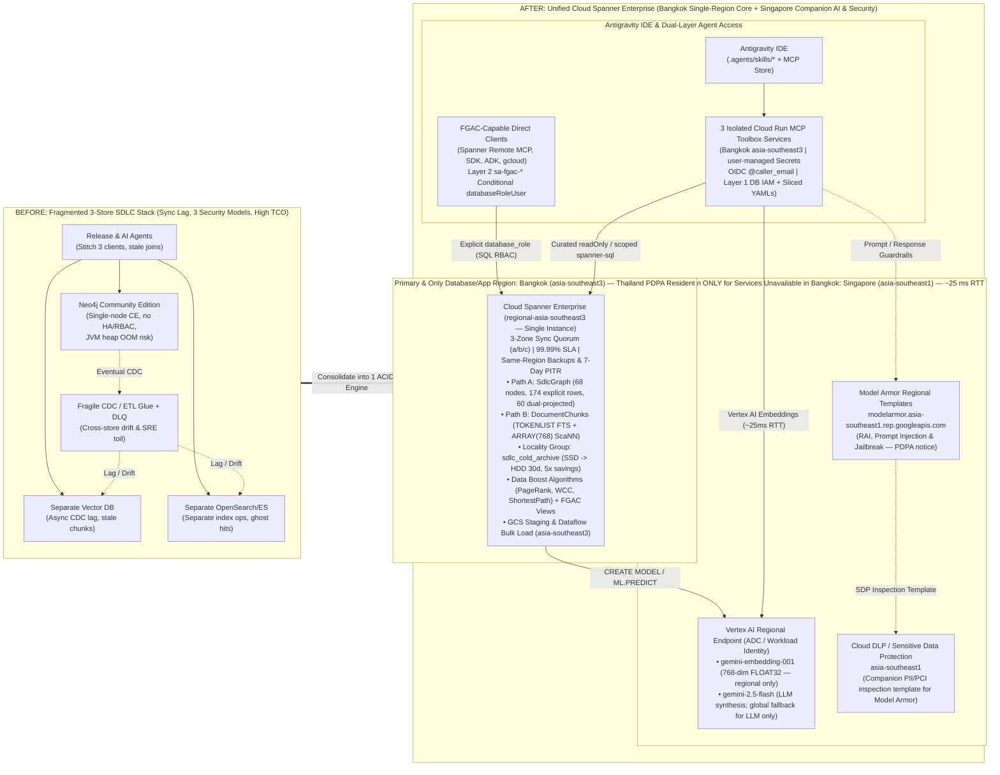

# Cloud Spanner Enterprise SDLC Knowledge Graph & GraphRAG Workshop

**Consolidate Neo4j Community Edition + a Separate Vector Database + a Separate Keyword Search Cluster into One Strongly Consistent Cloud Spanner Enterprise Platform.**

This hands-on enterprise workshop demonstrates **Use Case 4**: replacing a fragile 3-store SDLC architecture with a single ACID **Cloud Spanner Enterprise** database combining **Spanner Graph (ISO GQL)**, **Full-Text Search**, **ScaNN Vector Search**, **Serverless Data Boost Graph Algorithms**, and **secure multi-agent MCP Toolbox for Databases** access — anchored on the fictional **Acme Commerce Platform** and built on a strict **Bangkok single-region database/app architecture** for **Thailand PDPA** data residency.

> **Strict Regional Architecture (Single-Region Bangkok Core — NO 2-Region Spanner DR):**
> - **Primary & Only Database/App Region — Bangkok (`asia-southeast3` / `regional-asia-southeast3`):** Single **Cloud Spanner Enterprise** regional instance (3-zone synchronous quorum `asia-southeast3-a/b/c`, `99.99%` SLA, Thailand PDPA data residency, same-region Bangkok backups & 7-day PITR), **Cloud Run MCP Toolbox** services, **Secret Manager** (`user-managed` in `asia-southeast3`), and **GCS staging / Dataflow**.
> - **Companion Region (Fallback ONLY for GCP Services Unavailable in Bangkok) — Singapore (`asia-southeast1`, `~25 ms` RTT):** Used **strictly** for **Vertex AI** (`gemini-embedding-001` & `gemini-2.5-flash`), **Model Armor** (`modelarmor.asia-southeast1.rep.googleapis.com`), and **Cloud DLP / Sensitive Data Protection**.
> - **No 2-Region Spanner DR:** There is **no** second Spanner instance in Singapore, **no** cross-region Spanner backup copy workflow, and **`$0` cross-region DR backup egress** in this workshop.

---

## Start Here: 5-Minute Quickstart (Zero-Docker Default vs. With-Docker)

> **Zero-Docker First!** Every offline lab, simulator, pipeline dry-run, MCP RBAC proof, and unit test runs in **< 2 seconds** using only Python 3.10+ (zero Docker, zero `pytest`, zero GCP credentials required).

| Environment Path | What You Need | Recommended Start Commands |
| :--- | :--- | :--- |
| **Path 1 — Zero-Docker (Default)** | Python 3.10+, `make`, `bash` | `make preflight` → `make lab1-no-docker` → `make TRACK=starter verify-lab LAB=1` *(add `MODE=express` for Track A 4h Express)* |
| **Path 2 — With-Docker (Optional Track B)** | Above + Docker Desktop | Same as Path 1, plus optional local Neo4j 5 CE container in `data/structured/` (`docker compose up -d`) |
| **Live Bangkok GCP Sandbox (Optional)** | Above + `gcloud` CLI + Sandbox Project | `cp .env.example .env` → `make install` → `make provision-gcp` → `make verify-live` → `make cleanup-all-gcp` |

```bash
# 1. Run 5-second attendee readiness check (confirms Python, regional defaults & Zero-Docker path)
make preflight

# 2. Launch Lab 1 Zero-Docker Neo4j CE & APOC simulator (WALK vs TRAIL cycle explosion + 15/15 SHA-256 parity)
make lab1-no-docker

# 3. Verify all 8 Antigravity skills, run all 8 offline unittest modules & confirm starter/ stubs are armed
make validate-skills
make test
make verify-starter-stubs

# 4. Solve Labs 1-8 inside starter/ with instant green/red offline checks
make TRACK=starter verify-lab LAB=1                 # Track B (Full 15-file contract, default MODE=full)
make TRACK=starter MODE=express verify-lab LAB=1    # Track A (4-Hour Express core subset)
make TRACK=solution verify-lab LAB=all              # Compare against verified reference solution/

# 5. Run stdlib pipeline dry-runs, Hero offline fixture replay, Lab 6 mock RBAC & Bangkok TCO
make dry-run-pipelines
make demo-mcp-mock
make sizing PRESET=all REGION=asia-southeast3

# 6. List all 16 Makefile targets and configurable overrides (TRACK, LAB, MODE, PRESET, REGION, WORKSHEET)
make help
```

---

## Executive Overview & Hero Scenario

Engineering teams at **Acme Commerce Platform** maintain `12` microservices, `24` HTTP APIs, `10` Architecture Decision Records (ADRs), `14` compliance/SLA requirements, `8` engineering teams, and `45` unstructured Markdown design docs and runbooks. Throughout Labs 1–8, you build and verify a unified **Cloud Spanner Enterprise** GraphRAG engine that answers the **Hero Question** in one read-only ACID transaction with zero cross-store sync lag:

> **Hero Question:** *"What breaks if we change `POST /v2/payments/charge` (`api-payments-charge-v2`)?"*
>
> - **Deterministic 7-Row Impact Blast Radius** (`MATCH TRAIL` cycle-safe over `svc-orders <-> svc-notifications`):
>   1. `svc-billing` — Hop `1`, `DIRECT_SYNC`, `TIER_0` / `CRITICAL`, `team-billing` (`#billing-ledger`) — **flags legacy `AT_RISK` call to `DEPRECATED` `api-payments-charge-v1`**
>   2. `svc-checkout` — Hop `1`, `DIRECT_SYNC`, `TIER_0` / `CRITICAL`, `team-checkout` (`#checkout-orders`)
>   3. `svc-orders` — Hop `2`, `TRANSITIVE_UPSTREAM`, `TIER_1` / `HIGH`, `team-checkout` (`#checkout-orders`)
>   4. `svc-partner-gw` — Hop `2`, `TRANSITIVE_UPSTREAM`, `TIER_1` / `HIGH`, `team-integrations` (`#partner-messaging`)
>   5. `svc-notifications` — Hop `3`, `TRANSITIVE_UPSTREAM`, `TIER_2` / `MEDIUM`, `team-integrations` (`#partner-messaging`)
>   6. `svc-webhooks` — Hop `3`, `TRANSITIVE_UPSTREAM`, `TIER_2` / `MEDIUM`, `team-integrations` (`#partner-messaging`)
>   7. `svc-analytics` — Hop `3`, `DATA_FEED_CONSUMER`, `TIER_2` / `LOW`, `team-data` (`#data-analytics`) *(non-blocking analytical feed isolated from OLTP outage impact)*
> - **5 Governing ADRs:** `ADR-004` (`MANDATES`), `ADR-005`, `ADR-006`, `ADR-008`, `ADR-010` (`CONSTRAINS`)
> - **5 Applicable Requirements:** `REQ-001` (PCI-DSS 4.0), `REQ-002` (Tier-0 SLA & 45ms fraud budget), `REQ-003` (`> $500` fail-closed), `REQ-005` (SOX idempotent ledger), `REQ-006` (Zero-Trust mTLS/OIDC)
> - **9 Verifiable Unstructured Markdown Citations:** Grounded verbatim in `data/unstructured/` (`tok_pci_v2_<32hex>`, `45ms`, `> $500`, `180-day` Tier-0 freeze, `Idempotency-Key`, `AT_RISK` v1 sunset).

---

## BEFORE vs. AFTER Architecture (Bangkok Single-Region Core + Singapore Companion AI & Security)

All database, application, secret, and storage resources run strictly in **Bangkok (`asia-southeast3` / `regional-asia-southeast3`)** — a single **Cloud Spanner Enterprise** regional instance with 3-zone synchronous quorum (`asia-southeast3-a/b/c`), `99.99%` SLA, Thailand PDPA data residency, and same-region Bangkok backups/PITR (**no** 2-region Spanner DR instance). **Singapore (`asia-southeast1`, `~25 ms` RTT)** serves strictly as a companion region **only** for GCP services unavailable in Bangkok: **Vertex AI** (`gemini-embedding-001` & `gemini-2.5-flash`), **Model Armor**, and **Cloud DLP**:



> **Locked Guardrails & Deep Reference Tables:** All 9 Cloud Spanner invariants (`INV-01`–`INV-09`), verified 2026 Bangkok/Singapore pricing schedules, and MCP dual-layer authorization contracts live in [WORKSHOP_CONTENT_PLAN.md](WORKSHOP_CONTENT_PLAN.md), [GEMINI.md](GEMINI.md), and [WORKSHOP_SPEC.json](WORKSHOP_SPEC.json).

---

## Delivery Agendas: Track A (4-Hour Express) vs. Track B (8-Hour Deep-Dive)

Both tracks cover all **7 customer requirements** and finish with the Hero Blast-Radius GraphRAG query, prompt-injection fail-closed proof, and verified Bangkok Enterprise TCO readout. Use `MODE=express` for Track A (`make TRACK=starter MODE=express verify-lab LAB=1..8`) or default `MODE=full` for Track B (all 15 `starter/` files). See [docs/00_facilitator_guide.md](docs/00_facilitator_guide.md) for instructor checklists, demo cues, and `~$1.15/attendee` Bangkok cohort budgets.

| Lab | Req # | Participant Guide | Track A (4h) | Track B (8h) | Hands-On Deliverable (`starter/`) |
| :-: | :-: | :--- | :-: | :-: | :--- |
| **0** | Ops | [00_facilitator_guide.md](docs/00_facilitator_guide.md) | Pre-work | Pre-work | Instructor runbook, Zero-Docker room setup, `~$1.15/attendee` budget |
| **1** | 1 | [01_neo4j_community_migration.md](docs/01_neo4j_community_migration.md) | 30 min | 60 min | `make lab1-no-docker` simulator + `starter/sql/09_opencypher_to_gql_cookbook.sql` |
| **2** | 2 | [02_two_path_sdlc_workshop.md](docs/02_two_path_sdlc_workshop.md) | 20 min | 45 min | Path A/B convergence + `starter/sql/10_validate_migration_parity.sql` (68/174/60/45 parity) |
| **3** | 3 | [03_database_design_and_ingestion.md](docs/03_database_design_and_ingestion.md) | 45 min | 90 min | `01_path_a_schematized.sql`, `03_indexes_fts_vector_postload.sql`, Path A & Path B Python loaders |
| **4** | 4 | [04_search_strategy_options.md](docs/04_search_strategy_options.md) | 25 min | 60 min | `05_search_strategies_benchmark.sql` (FTS/Fuzzy/JSON/KNN/ScaNN) + `08_graph_algorithms_criticality.sql` |
| **5** | 5 | [05_hybrid_retrieval_and_graphrag.md](docs/05_hybrid_retrieval_and_graphrag.md) | 45 min | 75 min | `06_hybrid_rrf_rsf_filtered.sql` (RRF without `ROW_NUMBER()`) + `07_hero_api_blast_radius_graphrag.sql` |
| **6** | 6 | [06_mcp_toolbox_agent_security.md](docs/06_mcp_toolbox_agent_security.md) | 40 min | 75 min | `04_fgac_roles_views.sql`, `starter/mcp/tools.yaml`, `adk_multi_agent_demo.py`, prompt-injection demo |
| **7** | 7 | [07_sizing_and_cost_tco.md](docs/07_sizing_and_cost_tco.md) | 20 min | 45 min | Verified Bangkok single-region Enterprise pricing, CUDs, HDD tiering, 3-store TCO (`$0` cross-region DR) + `customer_scale_worksheet.json` |
| **8** | 7 | [08_observability_and_troubleshooting.md](docs/08_observability_and_troubleshooting.md) | 15 min | 30 min | `11_observability_and_studio_viz.sql` (`SAFE_TO_JSON(p)`, `SPANNER_SYS` Insights), same-region PITR/backups, `verify-live` & teardown |

---

## Live GCP Bangkok (`asia-southeast3`) Sandbox Lifecycle

> **Safety Gate:** Always copy `.env.example` to `.env`, set `GOOGLE_CLOUD_PROJECT`, and confirm with `make preflight STRICT_GCP=1` before running any live cloud command.

```bash
cp .env.example .env
# Edit .env and set GOOGLE_CLOUD_PROJECT=<your-sandbox-project>

# 0. Strict live-GCP preflight, clean ADC quota project & PEP-668-safe virtualenv SDK installation
make preflight STRICT_GCP=1
gcloud auth application-default set-quota-project "${GOOGLE_CLOUD_PROJECT}"
export SPANNER_DISABLE_BUILTIN_METRICS=true   # Optional: silences noisy OpenTelemetry metrics logs
make install          # Core pipeline SDKs (google-cloud-spanner, google-genai, pyyaml)
make install-mcp      # Optional Lab 6 live ADK/MCP & Model Armor packages

# 1. Provision Bangkok 100-PU Enterprise sandbox (--default-backup-schedule-type=NONE) + base DDL (~2 min)
make provision-gcp

# 2. Load Path A structured graph (<5s) and Path B 45 Markdown docs + 152 SG embeddings (~22s)
python3 solution/pipelines/neo4j_to_spanner_loader.py
python3 solution/pipelines/unstructured_graphrag_ingest.py

# 3. Apply 4-stage post-load (20 indexes + 5 FTS + ScaNN + ANALYZE; ~10 min on 100 PU — run before break!)
bash scripts/provision_workshop_env.sh apply-postload

# 4. Run live Hero Queries (33-520 ms), SQL scripts & live Bangkok verification suite
python3 labs/run_hero_query.py --query B --api-id api-payments-charge-v2 \
  --check-fixture solution/sql/fixtures/07_hero_expected_rows.json
make verify-live

# 5. Clean guaranteed zero-residual teardown (~2 min; zero lingering charges)
make cleanup-gcp          # Bangkok Spanner instance & same-region backups only
make cleanup-all-gcp      # Full teardown (Bangkok Cloud Run MCP, Secrets, SAs, GCS, Spanner + SG DLP/Model Armor) + verify_zero_residual.sh audit
```

### Live-Verified Bangkok (`asia-southeast3`) + Singapore Companion AI/Security (`asia-southeast1`) Timings

Validated end-to-end on a live GCP project (`100` PU single-region Cloud Spanner Enterprise, Cloud Run MCP, Secret Manager & GCS in Bangkok; Vertex AI, Model Armor & Cloud DLP in Singapore):

| Workshop Stage | Live Component / Command | Verified Duration | Notes |
| :--- | :--- | :---: | :--- |
| **Base DDL Create** | `provision_workshop_env.sh create` (`01`/`02`/`04`) | **~2 min** | Single Bangkok instance, DB, tables, views, FGAC roles, `SdlcGraph` |
| **Path A Load** | `neo4j_to_spanner_loader.py` (68 nodes, 174 explicit edges) | **< 5 s** | Includes `SdlcDynamicGraph` (`domain_key = node_id`) |
| **Path B + Embeddings** | `unstructured_graphrag_ingest.py` (45 docs, 152 × 768-dim) | **~22 s** | Live Singapore Vertex AI `gemini-embedding-001` (`~25 ms` RTT) |
| **4-Stage `apply-postload`** | 20 indexes + 5 FTS + ScaNN + `ANALYZE` (`100` PU) | **~10 min** | **Facilitator tip:** start right before morning break (or temporarily use `300` PU in live demos) |
| **Hero & SQL/GQL Queries** | Hero A/B/C (7-row fixture) + Labs `04b`/`05`/`06`/`09`/`10`/`11` | **33–520 ms** | ScaNN `VectorIndexScan` + FGAC `sdlc_readonly_role` ALLOW/DENY |
| **Lab 4 Data Boost Algos** | `PageRank`, `WeaklyConnectedComponents`, `ShortestPath` | **~3 min** | All 3 serverless Data Boost runs combined |
| **Lab 6 Full Deployment** | 3 BKK Cloud Run MCP (`v1.13.1`) + 3 BKK Secrets + 7 SAs + SG DLP/Model Armor | **~3–4 min** | Verified live OIDC-authenticated `/mcp` Hero GraphRAG call |
| **Lab 8 Full Teardown** | `make cleanup-all-gcp` (`verify_zero_residual.sh` 6-category audit) | **~2 min** | Removes all Bangkok + Singapore companion workshop resources cleanly |

---

## 8-Skill Antigravity Catalog (`.agents/skills/`)

This repository bundles **8 modular Antigravity IDE skills** alongside the always-on workspace rule [`.agents/rules/spanner-graph-workshop.md`](.agents/rules/spanner-graph-workshop.md). **Skills #1–#7 are 100% production-reusable** with zero Acme Commerce hardcoding — copy `.agents/skills/spanner-*` straight into your enterprise repositories after the workshop.

| # | Skill Name | Scope | Primary Labs | Purpose & Activation Scope |
| :-: | :--- | :---: | :---: | :--- |
| **1** | [`spanner-enterprise-platform-ops`](.agents/skills/spanner-enterprise-platform-ops/SKILL.md) | Production | 2, 7, 8 | Editions, CUDs, Bangkok single-region 3-zone topology (`99.99%` SLA), dialects, KV, Queues, CLI/SDKs/Emulator, Managed Autoscaler, same-region PITR, backups, drop protection. |
| **2** | [`spanner-schema-and-data-modeling`](.agents/skills/spanner-schema-and-data-modeling/SKILL.md) | Production | 3 | Split-safe PKs, `INTERLEAVE IN PARENT` vs `INTERLEAVE IN`, covering/expression indexes, FKs (`INV-06` dual-cascade ban), views/`SECURE_CONTEXT()`, Locality Groups, TTL, Change Streams DDL. |
| **3** | [`spanner-graph-modeling-and-gql`](.agents/skills/spanner-graph-modeling-and-gql/SKILL.md) | Production | 3, 4, 5, 8 | `CREATE PROPERTY GRAPH`, structural invariants, dual-projected edges, view-backed & `DYNAMIC LABEL` graphs, ISO GQL (`TRAIL`, `IS_FIRST`, `factorized_mode`), Data Boost Graph Algorithms (`PageRank`, `WCC`, `ShortestPath`), `SAFE_TO_JSON` Studio viz. |
| **4** | [`spanner-search-ai-and-graphrag`](.agents/skills/spanner-search-ai-and-graphrag/SKILL.md) | Production | 4, 5 | Vertex AI `CREATE MODEL` + `ML.PREDICT` embeddings (`asia-southeast1`), throttled PDML backfills, FTS (`SEARCH`, Custom Dictionaries, fuzzy n-grams), Exact KNN, ScaNN `CREATE VECTOR INDEX`, RRF/RSF/Filtered Hybrid Search, GraphRAG. |
| **5** | [`spanner-migration-and-neo4j-playbook`](.agents/skills/spanner-migration-and-neo4j-playbook/SKILL.md) | Production | 1 | 7-stage migrations (SMT, Datastream+Dataflow CDC, DVT, cutover), Neo4j CE APOC export & nodes-before-edges loading, openCypher v9 → ISO GQL parity, Elasticsearch → Spanner FTS. |
| **6** | [`spanner-mcp-toolbox-and-agent-security`](.agents/skills/spanner-mcp-toolbox-and-agent-security/SKILL.md) | Production | 6 | Antigravity MCP Store/`mcp_config.json`, ADK `ToolboxToolset`/`SpannerToolset`, Spanner Remote MCP, `tools.yaml` hardening, dual-layer DB IAM vs conditional `databaseRoleUser` FGAC, Model Armor, CMEK, VPC-SC. |
| **7** | [`spanner-performance-observability-and-sizing`](.agents/skills/spanner-performance-observability-and-sizing/SKILL.md) | Production | 7, 8 | Query Optimizer/`ANALYZE`, execution plans, `SPANNER_SYS` Insights (Query/Lock/Txn/Read), Key Visualizer, pre-splitting, CPU targets (65%/45%), node capacity & Bangkok/Singapore 3-store TCO. |
| **8** | [`sdlc-graphrag-workshop-guide`](.agents/skills/sdlc-graphrag-workshop-guide/SKILL.md) | Workshop | 2 *(all support)* | Acme Commerce 68/174/60/234/45 dataset catalog, Hero `api-payments-charge-v2` contract, `starter/` `TODO(Lab 1–8)` checkpoints, all 16 `Makefile` targets, and troubleshooting runbook. |

---

## Repository Directory Map (`starter/` vs. `solution/`)

Participants edit **only files inside `starter/`**; `data/`, `solution/`, and fixtures stay intact as the verified reference implementation.

```text
spanner-graph-sdlc-workshop/
├── README.md                              # Zero-Docker quickstart, architecture, agendas & overview
├── WORKSHOP_SPEC.json                     # Canonical machine-readable workshop contract
├── WORKSHOP_CONTENT_PLAN.md               # Deep curriculum design, pricing & 7-requirement outcomes matrix
├── GEMINI.md                              # Agent workspace orientation & locked invariants (INV-01..09)
├── Makefile                               # 16 offline/live targets (Zero-Docker first, stdlib unittest)
├── .env.example                           # Bangkok primary + Singapore companion AI/Security env template
├── .agents/
│   ├── rules/spanner-graph-workshop.md    # Always-on safety, residency, SQL & MCP guardrails
│   └── skills/                            # 8 modular Antigravity skills (7 production + 1 guide)
├── .antigravity/
│   ├── mcp_config.json                    # Zero-secret Antigravity IDE MCP server templates
│   └── README.md                          # MCP Store, npx, binary & Cloud Run setup guide
├── data/
│   ├── structured/                        # Path A: Zero-Docker simulator (no_docker_neo4j_sim.py), optional Docker/APOC, CSVs & JSONLs
│   └── unstructured/                      # Path B: 45 Markdown docs (services, apis, adrs, requirements, owners)
├── docs/
│   ├── 00_facilitator_guide.md            # Instructor runbook, ~$1.15/attendee budget, Q&A & teardown
│   └── 01..08_*.md                        # Complete Module 1–8 participant lab guides
├── labs/
│   └── run_hero_query.py                  # Parameterized read-only Hero Query runner (A/B/C/all, --dry-run)
├── scripts/
│   ├── preflight_check.sh                 # Fast 5-second attendee readiness & Zero-Docker check
│   ├── provision_workshop_env.sh          # create | apply-postload | cleanup [--all]
│   ├── run_live_sql.py                    # Multi-statement live/dry-run GoogleSQL & ISO GQL runner
│   ├── setup_antigravity_skills.sh        # Audits all 8 skills, rule file & MCP config (--link-legacy)
│   ├── verify_lab.py                      # Instant offline green/red grader (MODE=full|express)
│   ├── verify_live_gcp.sh                 # Live Bangkok DDL, ScaNN PLAN, Hero Query & FGAC verification
│   └── verify_zero_residual.sh            # Post-teardown 6-category zero-residual GCP audit
├── starter/                               # PARTICIPANT WORKSPACE: 15 TODO(Lab 1–8) exercise stubs
│   ├── README.md                          # Step-by-step participant starter guide (Zero-Docker + Express/Full)
│   ├── sql/                               # 10 SQL/GQL stubs (01, 03, 04, 05, 06, 07, 08, 09, 10, 11)
│   ├── pipelines/                         # 2 loader stubs (neo4j_to_spanner_loader, unstructured_graphrag_ingest)
│   ├── mcp/                               # 2 Lab 6 stubs (tools.yaml, adk_multi_agent_demo.py)
│   └── tools/customer_scale_worksheet.json# Lab 7 interactive customer sizing worksheet
├── solution/                              # VERIFIED REFERENCE IMPLEMENTATION
│   ├── sql/                               # Complete SQL/GQL scripts (01–11, 03a–03d, 04b) + fixtures/
│   ├── pipelines/                         # Complete Path A/B loaders, Dataflow script, apply_postload & offline Hero replay
│   ├── mcp/                               # Hardened tools.yaml, 3 rendered personas/*.yaml, IAM/Model Armor & ADK demo
│   └── tools/sizing_calculator.py         # Verified 2026 Bangkok/Singapore sizing & 3-store TCO engine
└── tests/                                 # 8 stdlib unittest modules verifying all contracts & scripts offline
```

---

## Official Public Documentation

- [Cloud Spanner Documentation](https://docs.cloud.google.com/spanner/docs)
- [Spanner Graph Overview & ISO GQL Reference](https://docs.cloud.google.com/spanner/docs/graph/overview)
- [Spanner Graph Algorithms (Data Boost)](https://docs.cloud.google.com/spanner/docs/graph/graph-algorithms)
- [Full-Text Search in Cloud Spanner](https://docs.cloud.google.com/spanner/docs/full-text-search)
- [Vector Search: Exact KNN & ScaNN ANN](https://docs.cloud.google.com/spanner/docs/find-approximate-nearest-neighbors)
- [Fine-Grained Access Control (FGAC)](https://docs.cloud.google.com/spanner/docs/fgac-about)
- [Cloud Spanner Pricing](https://cloud.google.com/spanner/pricing)
- [MCP Toolbox for Databases (Docs & GitHub)](https://github.com/googleapis/genai-toolbox)
- [Secure Agent Interactions with Cloud Spanner & MCP](https://docs.cloud.google.com/spanner/docs/secure-agent-interactions-mcp)
- [Cloud Spanner Best-Practice Samples](https://github.com/GoogleCloudPlatform/spanner-bb-samples)
