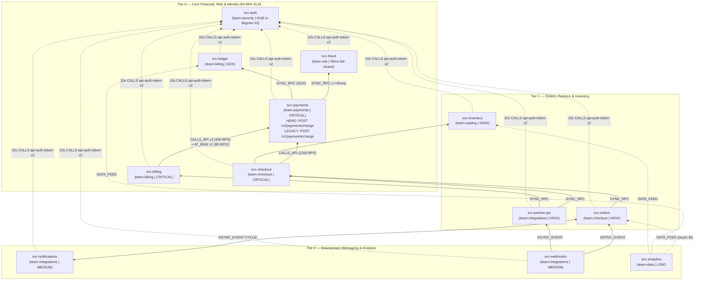

# Module 2: Two-Path SDLC Convergence & Regional Architecture

**Customer Requirement 2:** Converge **Path A (Structured SDLC Dependency Graph)** and **Path B (Unstructured Markdown Architecture & Compliance Artifacts)** inside a single strongly consistent **Cloud Spanner Enterprise** database in **Bangkok (`regional-asia-southeast3`)** with zero cross-store synchronization lag.

- **Duration:** Track A (4h Express): `20 min` | Track B (8h Deep-Dive): `45 min`
- **Primary Antigravity Skills:** [`sdlc-graphrag-workshop-guide`](../.agents/skills/sdlc-graphrag-workshop-guide/SKILL.md), [`spanner-enterprise-platform-ops`](../.agents/skills/spanner-enterprise-platform-ops/SKILL.md)
- **Support Skill:** [`spanner-schema-and-data-modeling`](../.agents/skills/spanner-schema-and-data-modeling/SKILL.md)
- **Hands-On Starter File:** [`starter/sql/10_validate_migration_parity.sql`](../starter/sql/10_validate_migration_parity.sql) (`TODO(Lab 2)`)
- **Reference Solution:** [`solution/sql/10_validate_migration_parity.sql`](../solution/sql/10_validate_migration_parity.sql), [`solution/sql/fixtures/10_row_hash_expected.json`](../solution/sql/fixtures/10_row_hash_expected.json)

---

## 1. Converging Path A (Structured) + Path B (Unstructured) in One Database

Traditional GraphRAG implementations split state across three loosely coupled engines: Neo4j for topology, Elasticsearch/OpenSearch for lexical search, and a separate vector store for semantic chunks. When an architect adds a new ADR or service call, CDC drift causes agents to return **stale dependencies** or **orphan citations**.

In **Cloud Spanner Enterprise**, Path A and Path B live side by side inside the same TrueTime ACID database (`sdlc_knowledge_graph`):

| Layer | Path | Source Corpus (`data/`) | Spanner Storage Representation | Exact Count |
| :--- | :---: | :--- | :--- | ---: |
| **Core Entities** | Path A | `data/structured/nodes/{owners,services,apis,adrs,requirements}.csv` | 5 static node tables (`Owners` 8, `Services` 12, `Apis` 24, `Adrs` 10, `Requirements` 14) | **68 nodes** |
| **Explicit M:N Edges** | Path A | 6 explicit edge CSVs under `data/structured/edges/` | 6 explicit edge tables (`ServiceCallsApi` 48, `ServiceDependsOnService` 28, `AdrGovernsApi` 36, `AdrSupersedesAdr` 3, `ReqAppliesToApi` 33, `ReqAppliesToService` 26) | **174 rows** |
| **Dual-Projected N:1 Edges** | Path A | 4 Neo4j parity CSVs (`api_exposes_from_service`, `owner_owns_*`) | Folded FK columns on node tables dual-projected as edges in `SdlcGraph` (zero redundant tables) | **60 edges** (`234` logical) |
| **Unstructured Prose** | Path B | `data/unstructured/{services,apis,adrs,requirements,owners}/*.md` | `DocumentChunks` (152 chunks: `TOKENLIST` FTS + `ARRAY<FLOAT32>(vector_length=>768)` ScaNN) + `ChunkEntityMentions` (1,160 links) + `ChunkCites*View` | **45 Markdown docs** |

---

## 2. Acme Commerce Platform Topology & 5 Baked-In Topological Traps



Every participant should recognize these **5 deliberate topological test traps** baked into the corpus:

1. **Intentional Bidirectional Cycle (`svc-orders <-> svc-notifications`, `ASYNC_EVENT`):** Forces `MATCH TRAIL` (Lab 1 & Lab 5) — naive `WALK` loops across the cycle edges.
2. **Isolated Async `DATA_FEED` Consumer (`svc-analytics -> {svc-orders, svc-ledger, svc-inventory}`):** Classifies `svc-analytics` as `DATA_FEED_CONSUMER` (hop 3, non-blocking analytical pipeline) rather than a customer-facing synchronous outage.
3. **High-Fanin Identity Hub (`svc-auth` / `api-auth-token-v2`, in-degree `10`):** Anchors `PageRank` criticality rankings and `IS_FIRST` super-node fanout capping (Lab 4).
4. **Legacy `AT_RISK` Payment Caller (`svc-billing -> api-payments-charge-v1`, `DEPRECATED`, `85` RPS):** Surfaces hidden migration exposure (`has_legacy_v1_risk = TRUE`) during `POST /v2/payments/charge` change reviews.
5. **ADR Governance & Supersession Lineage (`ADR-004 -> ADR-001`, `ADR-008 -> ADR-002`, `ADR-010 -> ADR-003`):** Separates historical `SUPERSEDED` policies from the 5 `ACCEPTED` ADRs governing `api-payments-charge-v2`.

---

## 3. Bangkok Primary + Singapore Secondary Regional Topology

| Design Choice | Locked Configuration | Rationale |
| :--- | :--- | :--- |
| **Primary Spanner & Cloud Run** | **Bangkok (`asia-southeast3` / `regional-asia-southeast3`)** | 3-zone synchronous quorum (`a/b/c`), **99.99% SLA**, Thailand PDPA primary residency (`REQ-007`), `$0.00/GiB` intra-region replication, `1.05x` US pricing (`$1.2915/node-hr` Enterprise). |
| **Vertex AI Embeddings & LLM** | **Singapore (`asia-southeast1`, `~25 ms` RTT)** | Regional `gemini-embedding-001` (768-dim `FLOAT32`) & `gemini-2.5-flash`. **Never** target `global` for `gemini-embedding-001` (`INV-09`). |
| **Disaster Recovery (DR)** | **Cross-region backup copy to `regional-asia-southeast1`** | Cloud Spanner has no pre-built Bangkok+Singapore dual-region config; cross-region backup copy costs `$0.08/GiB` egress + `$0.03432/GiB-mo` DR backup storage (`REQ-014`). |
| **Model Armor Guardrails** | **`modelarmor.asia-southeast1.rep.googleapis.com`** | Screens RAI, SDP, and prompt injection; document cross-jurisdictional prompt transit for Thailand PDPA reviews. |
| **Workshop Quota Fallback** | `--region asia-southeast1` | One-flag fallback if a workshop sandbox project lacks quota in `asia-southeast3` (`100` PU × 8 hr = `$1.1257` compute). |

### Optional Live Provisioning Step (Track B)

If you are executing against a live GCP project, prepare `.env` and preview/provision your `100` PU Bangkok Enterprise sandbox now (always confirm active project first!):

```bash
cp .env.example .env
# Edit .env to set GOOGLE_CLOUD_PROJECT=<your-sandbox-project>
gcloud config get-value project

# Preview every command safely with --dry-run first
bash scripts/provision_workshop_env.sh create --dry-run

# Provision live Bangkok 100-PU Enterprise sandbox (--default-backup-schedule-type=NONE)
make provision-gcp
# Or Singapore quota fallback: make provision-gcp REGION=asia-southeast1
```

---

## 4. Hands-On Exercise — Lab 2 (`starter/`)

Open [`starter/sql/10_validate_migration_parity.sql`](../starter/sql/10_validate_migration_parity.sql) and complete the `TODO(Lab 2)` assertions across all **4 parity tiers**:

- **Tier 1 (Global Counts):** Verify `total_nodes = 68`, `explicit_edge_rows = 174`, `dual_projected_edges = 60`, `total_logical_graph_edges = 234`, and `path_b_distinct_markdown_docs = 45` (`DocumentChunks`).
- **Tier 2 (Per-Label & Per-Edge Distribution):** Query `GRAPH_TABLE(SdlcGraph ...)` across all 5 node labels, 6 explicit edge types, and 4 dual-projected edge types.
- **Tier 3 (Topological Traps & Hero Contract):** Assert `svc-auth` in-degree `10`, `api-auth-token-v2` callers `10`, `svc-orders <-> svc-notifications` cycle edges `2`, `svc-analytics` `DATA_FEED` edges `3`, `svc-billing -> api-payments-charge-v1` `AT_RISK` call `1`, Hero API direct callers `2`, governing ADRs `5`, and applicable requirements `5`.
- **Tier 4 (Deterministic Content Hashes):** Compute canonical per-table `TO_HEX(SHA256(...))` and `BIT_XOR(FARM_FINGERPRINT(...))` matching [`solution/sql/fixtures/10_row_hash_expected.json`](../solution/sql/fixtures/10_row_hash_expected.json).

### Antigravity IDE Prompt (Copy-Paste)

> *"Using the `sdlc-graphrag-workshop-guide` and `spanner-enterprise-platform-ops` skills, help me complete the `TODO(Lab 2)` 4-tier parity checks in `starter/sql/10_validate_migration_parity.sql` matching the exact 68/174/60/234/45 Acme Commerce contract and all 5 topological traps. Do not edit `solution/` or `data/`."*

### Verify Lab 2 Offline

```bash
make TRACK=starter verify-lab LAB=2
```

**Checkpoint Expected Output:** `[PASS] Lab 2 (starter/)` — confirming `68` nodes, `174` explicit + `60` dual-projected (`234` logical) edges, `45` Markdown docs, and all 4 parity tiers.

---

**Navigation:** [← Module 1: Neo4j CE Migration](01_neo4j_community_migration.md) | [README](../README.md) | [Module 3: Database Design & Ingestion →](03_database_design_and_ingestion.md)
